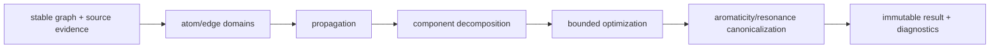

# Bond-order perception design

This document defines the chemistry ownership and uncertainty contract used by
the bond-order engine. `molcrys_kit.chemistry` is the only authority for
formal bond order, covalent/coordination/metallic kind, formal charge,
aromatic flags, and resonance alternatives. Structure modules own connectivity,
coordinates, periodic image shifts, disorder and source provenance. Geometry is
evidence used to rank compatible states; a distance alone never asserts a
formal order.

The pure entry point is:

```python
from molcrys_kit.chemistry import (
    BondOrderOptions, FiniteChemicalEntity, infer_bond_orders,
)

result = infer_bond_orders(
    entity,
    total_charge=None,
    options=BondOrderOptions(strict=False, max_search_states=100_000),
)
```

Inputs are immutable entities with stable atom IDs. A source order or aromatic
flag is fixed evidence and is never overwritten; contradictory source evidence
is retained as a diagnostic. A user-confirmed value has higher precedence than
an explicit file value, which has higher precedence than inference. The legacy
`infer_chemistry` function is an attaching adapter and preserves its historical
signature, while delegating to the same solver.

The solver first removes fixed edges from the residual problem, computes atom
valence domains, and propagates lower/upper residual bounds. Independent
components are solved separately when their charge constraints permit it.
Branching uses the smallest remaining domain and an incremental geometry score.
`max_search_states` bounds work and is reported as `TRUNCATED` when reached;
`max_candidates` only controls retained alternatives and cannot change the
best assignment. No fabricated single-bond result is returned after truncation.
Unknown elements, unsupported metal oxidation states, unresolved charge, and
chemically competitive assignments are represented as provisional or
indeterminate evidence.

An explicit ``total_charge`` is enforced for every candidate even when one or
more atoms have no inferred formal charge.  A missing atomic charge does not
skip the check and is not treated as zero.  The candidate is kept only when
every atom has a charge and the sum equals the requested total.  If no such
candidate remains, the result is ``INDETERMINATE``, strict mode raises, and
``diagnostics["total_charge_unsatisfied"]`` is true.  The constraint is not
applied when both the argument and the entity net charge are omitted.

Periodic vectors use the row-vector convention
`r_j + image_shift @ cell_A - r_i`, including triclinic cells. A periodic
self-edge contributes twice to the valence of its sole atom. Coordinates and
topology are never mutated by pure perception. Strict legacy calls restore all
existing chemistry and molecule attachments before raising on unresolved
results.

Aromaticity is a typed flag/resonance property, separate from numeric `1.5`
Kekulé averages. Ring planarity and lengths are geometry evidence only. The
benchmark package freezes independent truth fixtures and records unknowns,
timeouts, raw runs and missing Open Babel comparisons; it cannot claim the
release gates in issue #174 until the pinned QM9, external and CIF corpora and
native Open Babel protocol have been executed.


