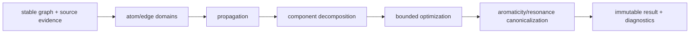

# Bond-order perception design

This document defines the chemistry ownership and uncertainty contract used by
the bond-order engine. `molcrys_kit.chemistry` is the only authority for
formal bond order, covalent/coordination/metallic kind, formal charge,
aromatic flags, and resonance alternatives. Structure modules own connectivity,
coordinates, periodic image shifts, disorder and source provenance. Geometry is
evidence used to rank compatible states; a distance alone never asserts a
formal order.

The pure entry point is:

```python
from molcrys_kit.chemistry import (
    BondOrderOptions, FiniteChemicalEntity, infer_bond_orders,
)

result = infer_bond_orders(
    entity,
    total_charge=None,
    options=BondOrderOptions(strict=False, max_search_states=100_000),
)
```

Inputs are immutable entities with stable atom IDs. A source order or aromatic
flag is fixed evidence and is never overwritten; contradictory source evidence
is retained as a diagnostic. A user-confirmed value has higher precedence than
an explicit file value, which has higher precedence than inference. The legacy
`infer_chemistry` function is an attaching adapter and preserves its historical
signature, while delegating to the same solver.

The solver first removes fixed edges from the residual problem, computes atom
valence domains, and propagates lower/upper residual bounds. Independent
components are solved separately when their charge constraints permit it.
Branching uses the smallest remaining domain and an incremental geometry score.
`max_search_states` bounds work and is reported as `TRUNCATED` when reached;
`max_candidates` only controls retained alternatives and cannot change the
best assignment. No fabricated single-bond result is returned after truncation.
Unknown elements, unsupported metal oxidation states, unresolved charge, and
chemically competitive assignments are represented as provisional or
indeterminate evidence.

An explicit ``total_charge`` is enforced for every candidate even when one or
more atoms have no inferred formal charge.  A missing atomic charge does not
skip the check and is not treated as zero.  The candidate is kept only when
every atom has a charge and the sum equals the requested total.  If no such
candidate remains, the result is ``INDETERMINATE``, strict mode raises, and
``diagnostics["total_charge_unsatisfied"]`` is true.  The constraint is not
applied when both the argument and the entity net charge are omitted.

Periodic vectors use the row-vector convention
`r_j + image_shift @ cell_A - r_i`, including triclinic cells. A periodic
self-edge contributes twice to the valence of its sole atom. Coordinates and
topology are never mutated by pure perception. Strict legacy calls restore all
existing chemistry and molecule attachments before raising on unresolved
results.

Aromaticity is its own graph authority, separate from numeric `1.5` Kekulé
averages. A chordless 5-, 6-, or 7-membered C/N/O/S ring is aromatic when its
pi-electron count is 4n+2: carbon and pyridine nitrogen contribute one, a
positively charged carbon contributes an empty p orbital, pyrrole nitrogen
and furan/pyrrole/thiophene heteroatoms contribute a lone pair, and a
saturated carbon (four sigma neighbors) blocks the ring. Fused rings share
the bonds that lie on any accepted cycle; a biphenyl bridge does not.
User-confirmed non-aromatic evidence locks the flag off. Ring planarity and
lengths only rank Kekulé forms.

Source precedence is user-confirmed, then explicit file evidence (CIF bond
type, line notation, IUPAC), then inference. `S`/`D`/`T` lock orders 1/2/3.
`A` and `delocalised` set the aromatic flag and leave the numeric order to
the solver. Contradictory evidence at the winning rank is flagged and does
not overwrite either value.

Variable bonds are decomposed into connected components. Forests are solved
by tree dynamic programming with the same valence rules as the bounded
search. Cyclic components stay on that search. A requested total charge is
checked after the pieces are merged; if the independent optima miss it, the
joint search runs. Geometry scores are squared bond-length residuals and
never create an order by themselves.

Functional acceptance for issue #174 is this engine: aromaticity, source
precedence, component decomposition, tree dynamic programming, geometry
ranking, and the section 4.1 micro-family tests. The benchmark package freezes
the independent micro manifest and records unknowns, timeouts, and missing
comparisons. Open Babel 3.2.1 paired runs, the section 5 superiority gates,
latency, throughput, RSS, QM9, and the curated external and CIF corpora are
issue #176. They stay visible on the scorecard and do not change
`score --strict-gates`.


